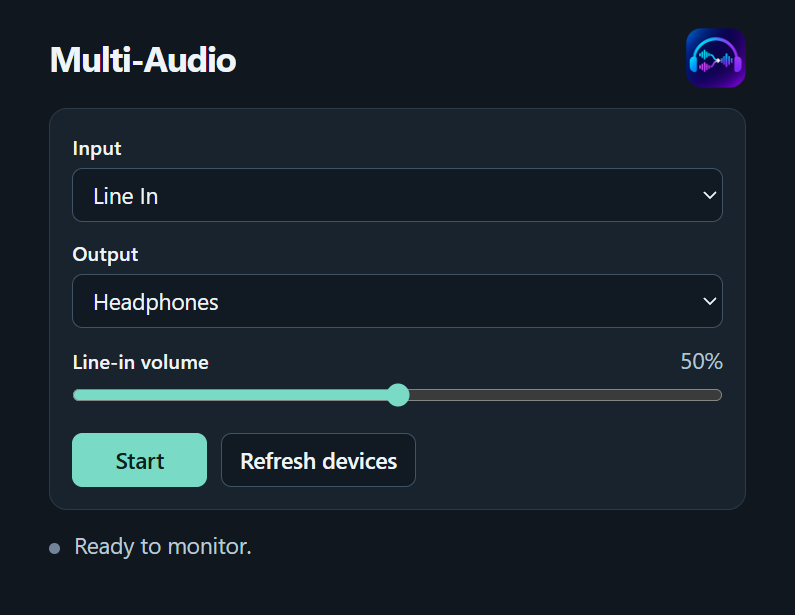
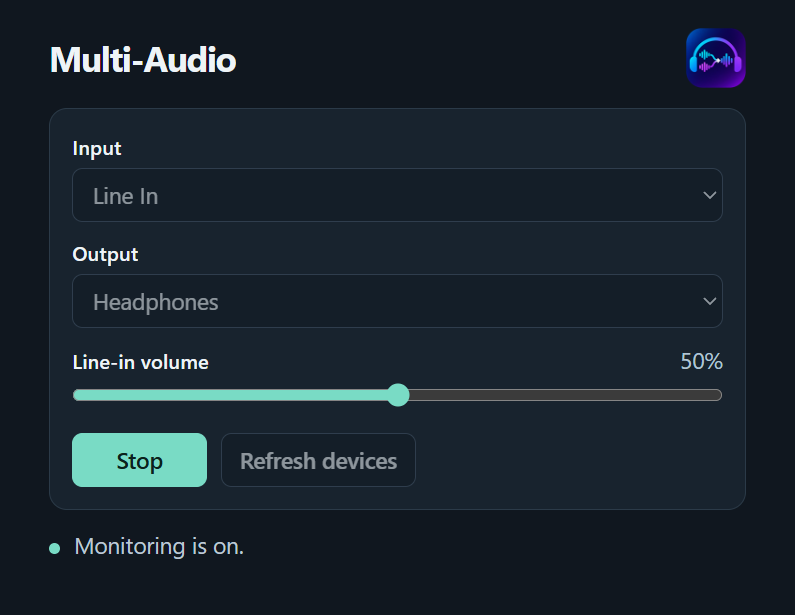

# Multi-Audio

Multi-Audio is a Windows desktop app that plays an external audio source alongside your PC audio. Connect a game console, mixer, or another device to a line input and hear both through the same headphones or speakers. Audio stays on your device.




## Run on Windows

1. Connect the external device's audio output to a line input on your PC or audio interface.
2. Open `MultiAudio.exe`. Select the line input and the playback device you use for Windows audio.
3. Click **Start** and adjust **Line-in volume** to balance the two sources.

If the input is missing, click **Refresh devices** and check that it is enabled in Windows sound settings.

The single-file build targets 64-bit Windows and includes the .NET runtime. The Photino interface requires Microsoft Edge WebView2 Runtime.

## Build

Run this command from the directory containing `MultiAudio.csproj` with the .NET 10 SDK.

```powershell
dotnet publish -c Release -r win-x64 --self-contained -p:PublishSingleFile=true -p:IncludeNativeLibrariesForSelfExtract=true -p:EnableCompressionInSingleFile=true -p:DebugType=None -o dist/photino
```
